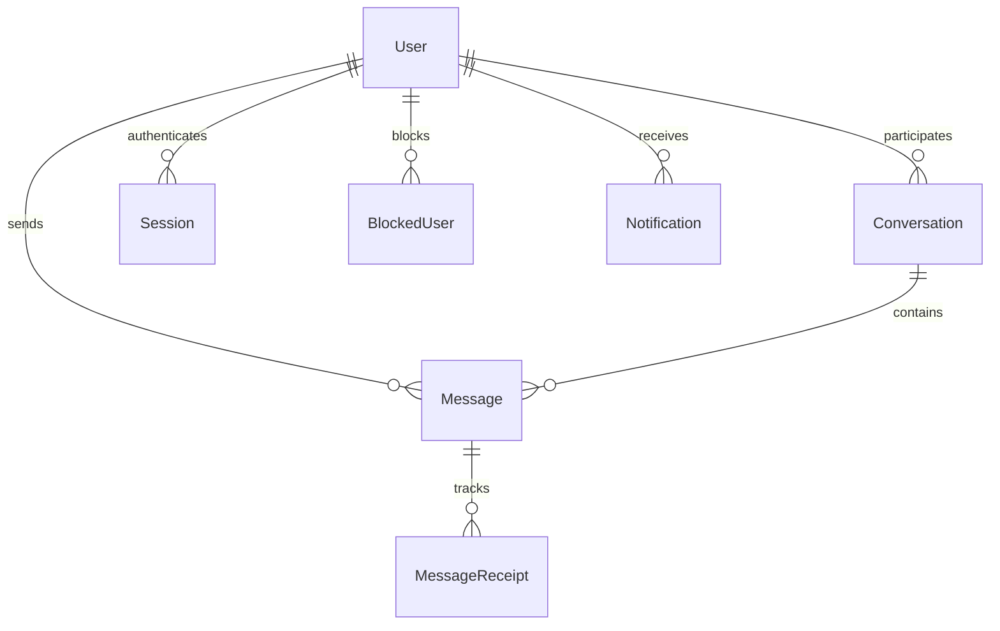

# Database Schema Documentation: MongoDB & Mongoose Models

## 1. Entity Relationship Overview

---

## 2. Models Detail

### 2.1 `User` (`src/models/User.js`)
- `username`: `String` (Unique, index, lowercase, 3-30 chars).
- `email`: `String` (Unique, index, lowercase, valid email).
- `passwordHash`: `String` (Scrypt derived key + salt).
- `displayName`: `String` (Max 50 chars).
- `avatar`: `String` (URL to image).
- `phone`: `String`.
- `about`: `String` (Status message, max 140 chars).
- `isAI`: `Boolean` (True for Meta AI system persona).
- `online`: `Boolean` (Live presence state).
- `lastSeen`: `Date` (Timestamp of last activity).
- `blockedUsers`: `[ObjectId]` (References `User`).
- `pinnedConversations`: `[ObjectId]` (References `Conversation`).
- `archivedConversations`: `[ObjectId]` (References `Conversation`).
- `mutedConversations`: `[ObjectId]` (References `Conversation`).

### 2.2 `Conversation` (`src/models/Conversation.js`)
- `type`: `String` (`"direct"` | `"group"`).
- `slug`: `String` (Unique, sparse, used for starter rooms: `general`, `webdev`, `devteam`, `meta-ai`).
- `participants`: `[ObjectId]` (References `User`).
- `admins`: `[ObjectId]` (References `User` for group moderators).
- `createdBy`: `ObjectId` (References `User`).
- `groupMeta`:
  - `name`: `String` (Max 100 chars).
  - `description`: `String` (Max 500 chars).
  - `avatar`: `String`.
- `lastMessage`:
  - `text`: `String`.
  - `senderId`: `String`.
  - `senderName`: `String`.
  - `timestamp`: `Date`.
- `unreadCounts`: `Map of Number` (Mapped by userId string).

### 2.3 `Message` (`src/models/Message.js`)
- `conversationId`: `ObjectId` (Index, references `Conversation`).
- `roomId`: `String` (Index, for starter slug compatibility).
- `sender`:
  - `id`: `String`.
  - `userId`: `ObjectId` (References `User`).
  - `username`: `String`.
  - `avatar`: `String`.
  - `isAI`: `Boolean`.
- `text`: `String` (HTML sanitized).
- `mediaType`: `String` (`"text"`, `"image"`, `"video"`, `"audio"`, `"voice"`, `"document"`, `"file"`).
- `mediaUrl`: `String` (Secure path under `/uploads/`).
- `mediaName`: `String`.
- `mediaSize`: `Number` (Bytes).
- `replyTo`:
  - `messageId`: `ObjectId` (References `Message`).
  - `text`: `String`.
  - `senderName`: `String`.
- `status`: `String` (`"sent"`, `"delivered"`, `"read"`).
- `reactions`: `[{ user: String, emoji: String }]`.
- `isDeletedForEveryone`: `Boolean` (Default false).
- `deletedFor`: `[ObjectId]` (User IDs who hid message for themselves).

### 2.4 `Session` (`src/models/Session.js`)
- `userId`: `ObjectId` (Index, references `User`).
- `refreshTokenHash`: `String` (Index, SHA-256 hash).
- `userAgent`: `String`.
- `ip`: `String`.
- `expiresAt`: `Date` (TTL index).

### 2.5 `BlockedUser` (`src/models/BlockedUser.js`)
- `blocker`: `ObjectId` (Index, references `User`).
- `blocked`: `ObjectId` (Index, references `User`).
- `reason`: `String`.

### 2.6 `AuditLog` (`src/models/AuditLog.js`)
- `action`: `String` (Index).
- `actor`: `{ userId, username, ip, userAgent }`.
- `targetResource`: `{ type, id }`.
- `details`: `Mixed`.
- `status`: `String` (`"success"`, `"failure"`, `"warning"`).

### 2.7 `Notification` (`src/models/Notification.js`)
- `recipient`: `ObjectId` (Index, references `User`).
- `sender`: `ObjectId` (References `User`).
- `type`: `String` (`"message"`, `"mention"`, `"group_invite"`, `"call"`, `"system"`).
- `title`: `String`.
- `body`: `String`.
- `conversationId`: `ObjectId`.
- `isRead`: `Boolean` (Default false).

### 2.8 `MessageReceipt` (`src/models/MessageReceipt.js`)
- `messageId`: `ObjectId` (Index, references `Message`).
- `recipientId`: `ObjectId` (Index, references `User`).
- `status`: `String` (`"sent"`, `"delivered"`, `"read"`).
- `deliveredAt`: `Date`.
- `readAt`: `Date`.
